# GS/OS95 – Benutzerhandbuch

*Version 2.18 · Build 2.1.47 · Erstellt von Marc Golombeck*
*English version: [Manual.md](Manual.md)*

GS/OS95 ist eine Oberfläche im Stil von Windows 95 für den Apple IIgs. Sie ersetzt den Finder von GS/OS
und bringt Startmenü, Taskleiste, Explorer, Papierkorb, einen Webbrowser, ein Terminal und eine Reihe
kleiner Programme mit.

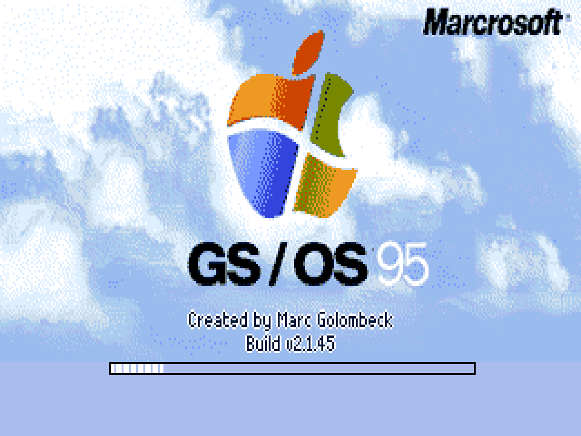

---

## Inhalt

1. [Installation und Start](#1-installation-und-start)
2. [Der Schreibtisch](#2-der-schreibtisch)
3. [Explorer: Dateien und Ordner](#3-explorer-dateien-und-ordner)
4. [Systemsteuerung](#4-systemsteuerung)
5. [Netzwerk einrichten](#5-netzwerk-einrichten)
6. [Internet (Browser)](#6-internet-browser)
7. [Terminal, Telnet und SSH](#7-terminal-telnet-und-ssh)
8. [MS-DOS-Eingabeaufforderung](#8-ms-dos-eingabeaufforderung)
9. [Paint](#9-paint)
10. [Weitere Programme](#10-weitere-programme)
11. [Programme anderer Hersteller](#11-programme-anderer-hersteller)
12. [Tastenkürzel](#12-tastenkürzel)
13. [Dateien von GS/OS95](#13-dateien-von-gsos95)
14. [Bekannte Grenzen und Tipps](#14-bekannte-grenzen-und-tipps)

---

## 1. Installation und Start

**Was man braucht**

- einen Apple IIgs (getestet im Emulator GSSquared mit ROM 3) oder einen Emulator wie GSSquared, KEGS, GSplus oder MAME;
- das Festplatten-Image `GSOS95_v2147_System.hdv` (32 MB, ProDOS) aus dem Ordner `image/`.

**Einrichten**

- **Emulator:** Image als Startlaufwerk einhängen (Slot 7, Laufwerk 1).
- **Echter IIgs:** Image auf eine Karte für BlueSCSI, CFFA3000, MicroDrive o. Ä. kopieren und davon starten.

Wichtig: Das Image nicht von außen verändern, solange es im Emulator eingehängt ist und das System läuft.
Sonst kann das Dateisystem beschädigt werden.

**Der Start**

Gleich nach dem Einschalten erscheint das Startbild mit Ladebalken. GS/OS lädt Treiber und
Systemerweiterungen, danach übernimmt GS/OS95. Der Balken läuft bis zum Ende weiter, dann steht der
Schreibtisch da. Ordnerfenster, die beim letzten Mal offen waren, öffnen sich wieder.

Kurz nach dem Einschalten spielt ein Startklang (abschaltbar unter Einstellungen > Ton).

**Sprache:** Deutsch oder Englisch, umschaltbar in der Systemsteuerung (Symbol „Deutsch“/„English“).

---

## 2. Der Schreibtisch

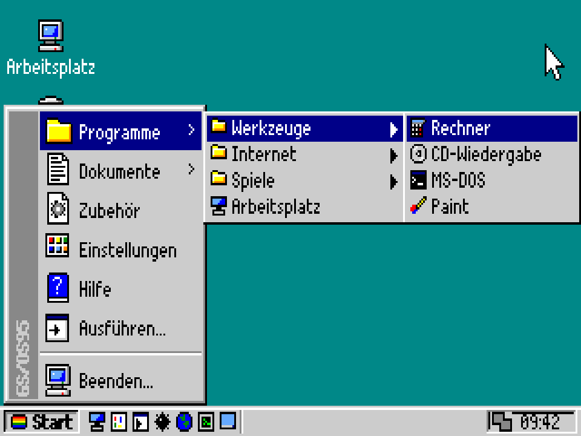

**Symbole auf dem Schreibtisch**

- **Arbeitsplatz:** alle Laufwerke.
- **Papierkorb:** gelöschte Dateien, wiederherstellbar.
- **Liesmich:** kurze Einführung.
- **Verknüpfungen:** bis zu 6 eigene (siehe unten).

**Taskleiste (unten)**

- **Start-Knopf:** öffnet das Startmenü (auch mit der Tab-Taste).
- **Schnellstartleiste:** Arbeitsplatz, Einstellungen, Ausführen, Minesweeper, Internet, Terminal und
  „Desktop anzeigen“ (minimiert alle Fenster, ein zweiter Klick holt sie zurück).
- **Fensterknöpfe:** ein Knopf je offenem Fenster. Ein Klick holt das Fenster nach vorn, beim aktiven
  Fenster minimiert er es.
- **Netzwerksymbol:** blau heißt verbunden, grau nicht verbunden. Ein Klick öffnet die Netzwerk-Einstellungen.
- **Uhr:** ein Klick öffnet „Datum/Uhrzeit“ mit Monatskalender und Zifferblatt (siehe Abschnitt 10).

**Startmenü**

| Eintrag | Inhalt |
|---|---|
| Programme | Werkzeuge (Rechner, CD-Wiedergabe, MS-DOS, Paint, Editor), Internet (Internet, Terminal, Software-Archiv, Nachrichten, Wetter), Spiele (Minesweeper, Solitär), Arbeitsplatz und eigene Programme |
| Dokumente | die 8 zuletzt geöffneten Dateien |
| Zubehör | alle Schreibtischzubehöre (NDAs) aus `*:System:Desk.Accs` |
| Einstellungen | Systemsteuerung |
| Hilfe | Übersicht der Tastenkürzel (about:keys) |
| Ausführen… | Programm oder Datei über den Pfad starten |
| Beenden… | Herunterfahren (H), Neu starten (N) oder zum GS/OS-Modus wechseln (F) |

Das Startmenü lässt sich vollständig mit der Tastatur bedienen: Pfeiltasten, Return, Esc.

**Eigene Programme und Verknüpfungen**

Mit Wahltaste-Klick (Option) auf eine Datei öffnet sich ein Kontextmenü. Darin gibt es
**„Ins Startmenü“** (erscheint unter Programme; ein zweites Mal entfernt den Eintrag) und
**„Auf den Desktop“** (legt eine Verknüpfung an). Entf entfernt eine markierte Verknüpfung, die Datei
selbst bleibt erhalten.

**Fenster**

Fenster lassen sich verschieben (Titelleiste), in der Größe ändern (Griff unten rechts), maximieren
(Knopf oder Doppelklick auf die Titelleiste), minimieren und schließen (X oder Esc). Apfel-Tab holt das
nächste Fenster nach vorn.

**Bildschirmschoner**

Zwei Schoner, Sternenfeld und Linienspiel, wechseln sich ab. Unter Einstellungen > Anzeige stellt man
„Schoner (Min.)“ auf 1 bis 15 Minuten, 0 schaltet ihn ab. Ab Werk ist er aus.

**Boss-Taste**

Wahl-Apfel-C (oder Strg-Apfel-C) zeigt einen täuschend echten Bluescreen von Windows 95. Jede Taste
führt zurück, es passiert nichts.

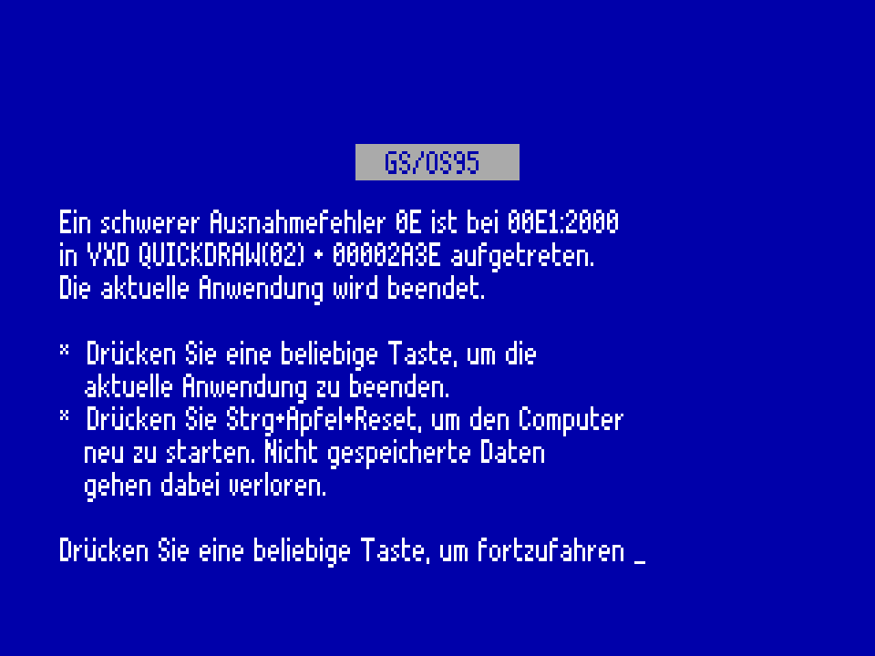

---

## 3. Explorer: Dateien und Ordner

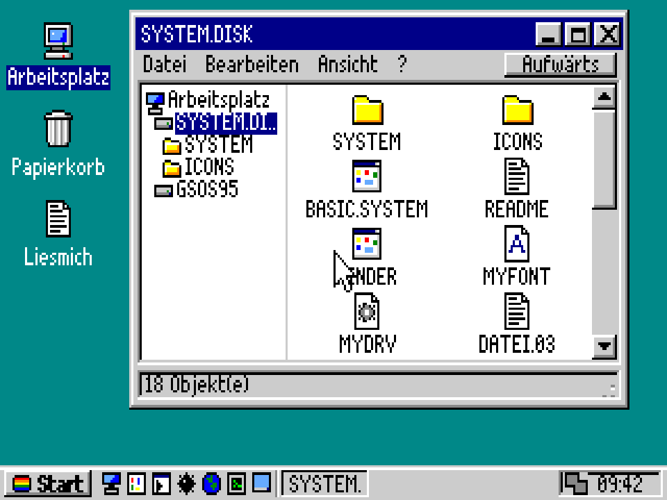

Doppelklick auf **Arbeitsplatz** zeigt die Laufwerke, Doppelklick auf ein Laufwerk oder einen Ordner
öffnet ihn. Bis zu 6 Explorer-Fenster können gleichzeitig offen sein.

**Ansichten (Menü Ansicht)**

- **Symbole oder Details:** Details zeigt Name, Größe und Typ.
- **Sortieren** nach Name, Größe oder Typ; Ordner stehen immer zuerst.
- **Ordnerbaum** links mit Pfad, Nachbarordnern und Laufwerken. Ein Klick wechselt dorthin.

Ansicht und Sortierung werden gemerkt.

**Markieren:** Klick, Shift- oder Apfel-Klick für mehrere Objekte, Strg-A für alles.

**Bearbeiten**

| Aktion | So geht's |
|---|---|
| Kopieren / Ausschneiden / Einfügen | Strg-C / Strg-X / Strg-V, mit Fortschrittsanzeige und „Abbrechen“ |
| Ziehen und Ablegen | auf einen Ordner, ein anderes Fenster, ein Laufwerk oder den Papierkorb. Gleiches Laufwerk = verschieben, anderes = kopieren |
| Neuer Ordner | Strg-N |
| Umbenennen | Strg-E |
| Löschen (in den Papierkorb) | Strg-D |
| Eigenschaften | Strg-P |
| Duplizieren | Datei > Duplizieren (legt KOPIE.Name an) |
| Suchen | Datei > Suchen… (Ordner samt Unterordnern) |
| Aktualisieren | Strg-R |
| Diskette auswerfen | Strg-L |

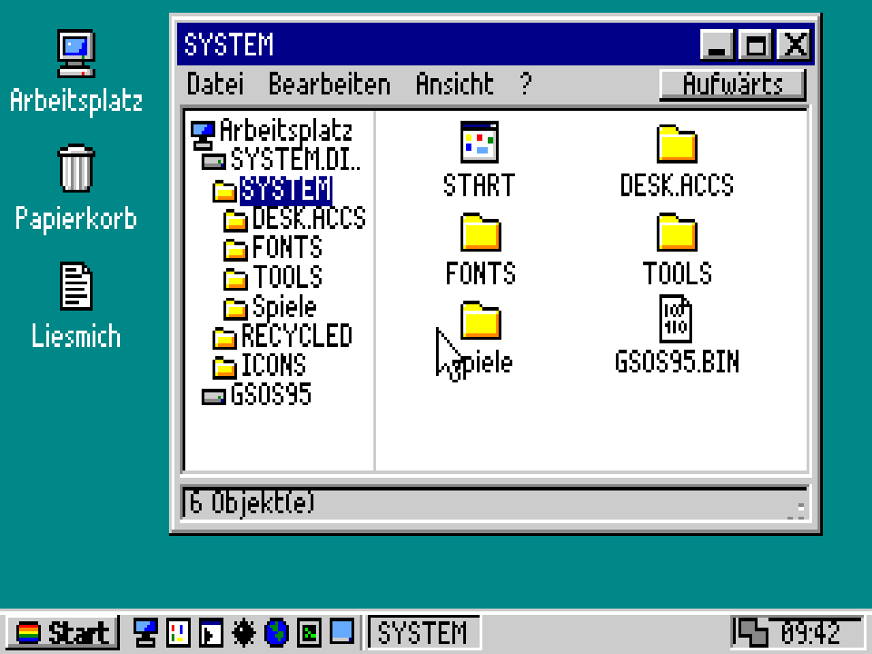

**Eigenschaften**

Hier lassen sich Dateityp und Zusatztyp ändern (hexadezimal) und der Schreibschutz setzen. Bei
Textdateien zeigt das Fenster den Anfang des Textes, bei Bildern eine farbige Miniatur.

**Dateien öffnen**

- **Programme** (S16, SYS, EXE) starten per Doppelklick. Nach dem Beenden kehrt man zu GS/OS95 zurück.
- **Textdateien** (TXT, SRC) öffnen sich im Editor (Abschnitt 10).
- **Dokumente** öffnen sich mit ihrem Programm, so wie es in den Symboldateien unter `*:Icons` eingetragen ist.
- **BASIC-Programme** starten über BASIC.SYSTEM.
- **Bilder** im Format $C1, gepackt ($C0/0001) oder Apple Preferred ($C0/0002) erscheinen bildschirmfüllend.
  Taste B öffnet das Bild in Paint.
- **Klangdateien** ($D8) werden abgespielt.

**Papierkorb**

Gelöschte Objekte landen im Papierkorb. „Wiederherstellen“ (Datei-Menü oder Strg-E) legt sie an
ihren alten Platz zurück. „Papierkorb leeren“ zeigt den Fortschritt an. Mit gedrückter Wahltaste wird
ohne Rückfrage geleert.

**Laufwerke**

- **Datenträger** lassen sich im Arbeitsplatz umbenennen, löschen und kopieren: Laufwerk kopieren,
  Ziel markieren, Einfügen.
- **Unformatierte Disketten** werden erkannt und zum Formatieren angeboten.
- **5,25"-Laufwerke** werden erst beim Öffnen gelesen, weil ein leeres Laufwerk sonst lange braucht.
- Optional zeigt der Schreibtisch die Laufwerke rechts an, wie beim Mac: Einstellungen > Anzeige > „Laufwerke zeigen“.

**Systemordner**

Zieht man Kontrollfelder, Zubehör, Schriften, Treiber, Werkzeuge oder Erweiterungen auf den Ordner
System, sortiert GS/OS95 sie auf Wunsch in die passenden Unterordner ein.

---

## 4. Systemsteuerung

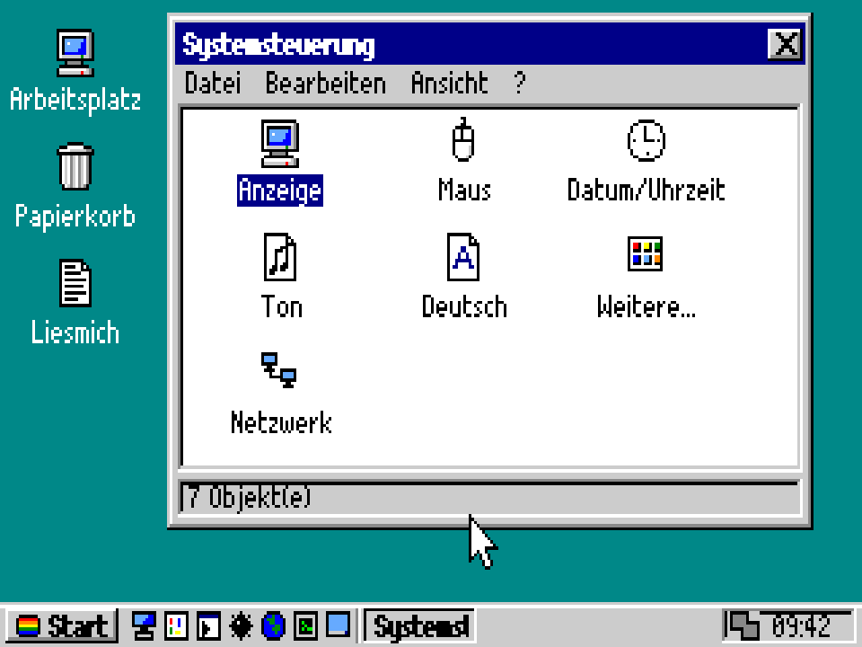

Start > Einstellungen oder das Symbol in der Schnellstartleiste.

| Symbol | Einstellungen |
|---|---|
| Anzeige | Desktop- und Randfarbe, Hintergrundmuster (0–4), Bildschirmschoner (Minuten), Laufwerke auf dem Desktop |
| Maus | Doppelklick-Tempo, schnelle Maus |
| Datum/Uhrzeit | stellt die Systemuhr |
| Ton | Lautstärke, Tonhöhe, Startklang |
| Deutsch / English | Sprache der Oberfläche |
| Netzwerk | Netzwerkkarte, Adressen, Proxy (siehe Abschnitt 5) |
| Weitere… | Apples Kontrollfelder (für Kontrollfelder anderer Hersteller) |

Bedienung auch mit Pfeiltasten, Return und Esc. Die Werte stehen im Battery-RAM bzw. in
`*:System:GSOS95.PREFS`.

---

## 5. Netzwerk einrichten

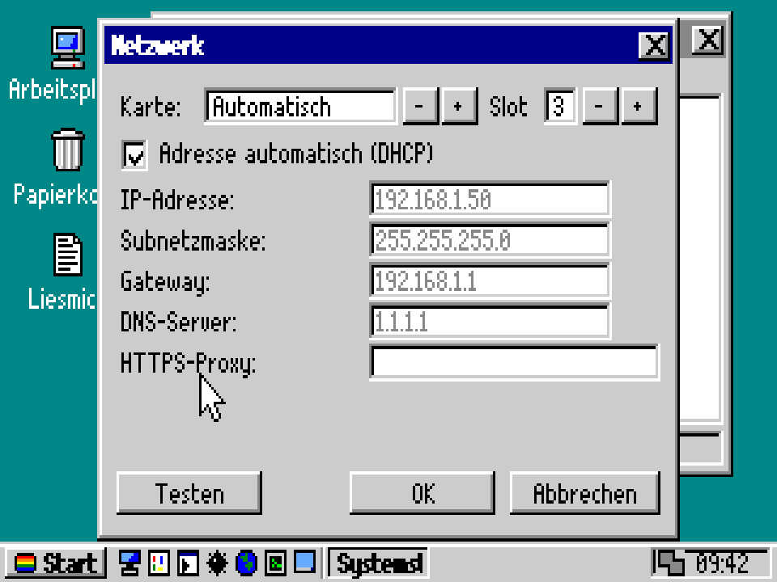

Einstellungen > Netzwerk. Mit den Knöpfen − und + wählt man die Karte:

| Karte | Hinweise |
|---|---|
| **Automatisch** | sucht der Reihe nach CoGS, FujiNet, Marinetti und Uthernet II |
| **Uthernet II** | wird direkt angesprochen, ohne Marinetti. Slot einstellen (Vorgabe 3). DHCP oder feste Adressen. https nur über einen Proxy |
| **CoGS** | bringt WLAN/Kabel, DHCP, DNS und **TLS** selbst mit, https geht direkt |
| **FujiNet** | über den SmartPort. https, **SSH** und **FTP** erledigt die FujiNet selbst |
| **Marinetti** | nutzt den TCP/IP-Stapel von Marinetti 3.0 (liegt auf dem Image), damit jede Karte mit passender Verbindungsschicht: Uthernet I, LANceGS, SLIP/PPP … |
| **WLAN-Modem** | serieller Anschluss (WiModem232, Zimodem, WiFi232), 2400–57600 Baud |

„Testen“ startet die Karte und fragt den Namensdienst. Klappt DHCP nicht, gelten die festen Adressen.

**https ohne CoGS/FujiNet:** Einen Proxy im Heimnetz eintragen, der die Verschlüsselung übernimmt
(z. B. WebOne oder Macproxy), im Feld „HTTPS-Proxy“ oder im Browser mit `about:proxy=192.168.1.10:8080`.

**Uhrzeit aus dem Internet:** Beim ersten Seitenaufruf stellt GS/OS95 die Uhr des IIgs nach einem
Zeitserver. Die Zeitzone ändert man im Browser:

- `about:tz=+1eu` – Mitteleuropa mit Sommerzeit (Vorgabe)
- `about:tz=-5us` – US-Ostküste mit Sommerzeit
- `about:tz=+0` – ohne Sommerzeit
- `about:tz=off` – Zeitabgleich aus

`about:net` zeigt den Netzwerkstatus mit einem Verbindungstest.

**Emulator GSSquared:** Dort eine Karte mit `card = "uthernet2"` einbauen. DHCP antwortet dort nicht,
die festen Adressen funktionieren aber.

---

## 6. Internet (Browser)

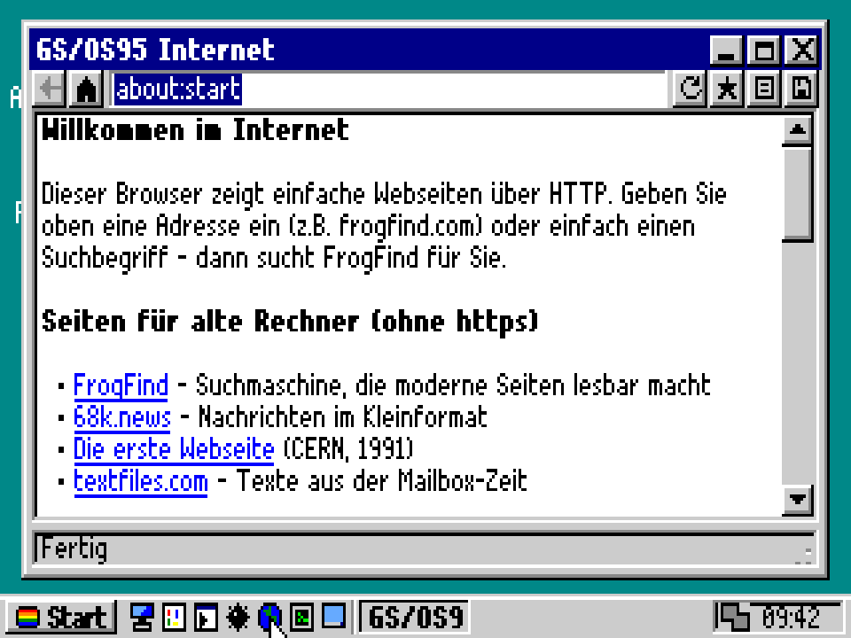

Start > Programme > Internet oder der Globus in der Schnellstartleiste.

**Adresszeile:** Eine Adresse (z. B. `frogfind.com`) oder einen Suchbegriff eintippen und Return drücken.
Links daneben liegen Zurück und Startseite, rechts Neu laden, Merken (Stern), Lesezeichen (Liste) und
Speichern (Diskette).

**Was der Browser kann**

- HTTP mit Weiterleitungen und Cookies, beliebig große Seiten (bis 16 KB Text werden angezeigt).
- Überschriften, Listen, Tabellen, Zitate und vorformatierter Text; Umlaute aus UTF-8, Latin-1 und Windows-1252.
- **GIF-Bilder** in der Seite (bis 8): Ein Klick zeigt sie groß, Esc überspringt das Laden.
- **Formulare:** Textfelder, Ankreuzfelder, Auswahllisten, Knöpfe; GET und POST.
- **Downloads:** Alles, was keine Seite ist, landet in `*:Downloads`. Strg-S speichert die aktuelle Seite.
- **Protokolle:** `http://`, `https://`, `gopher://`, `ftp://`, `telnet://`, `ssh://`, `irc://`.

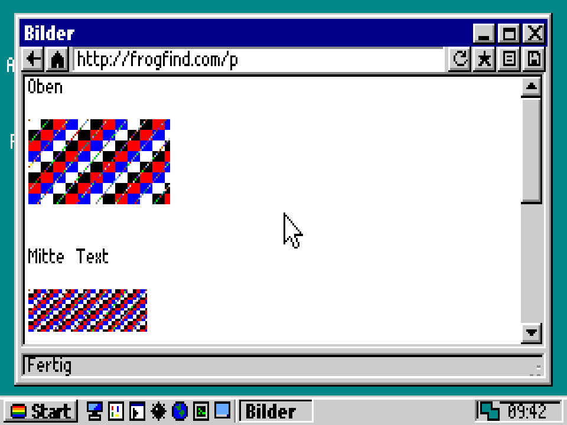

**Lesezeichen, Verlauf, Suche**

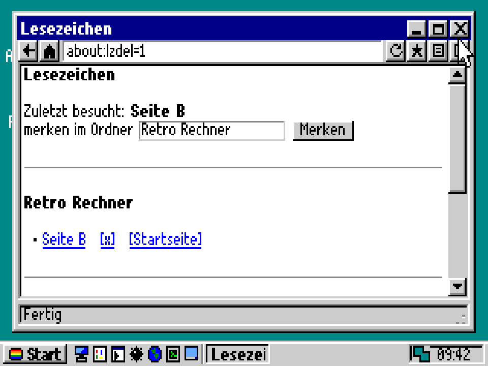

- **Strg-D** (oder der Stern) merkt die Seite. **Strg-B** öffnet die Lesezeichen (`about:lz`). Dort
  gibt es Ordner, `[x]` löscht einen Eintrag, `[Startseite]` macht ihn zur Startseite.
- **Verlauf:** die letzten 20 Seiten unter `about:verlauf`.
- **Suchmaschine:** wählbar auf der Lesezeichenseite: FrogFind, wiby.me oder DuckDuckGo.

**FTP**

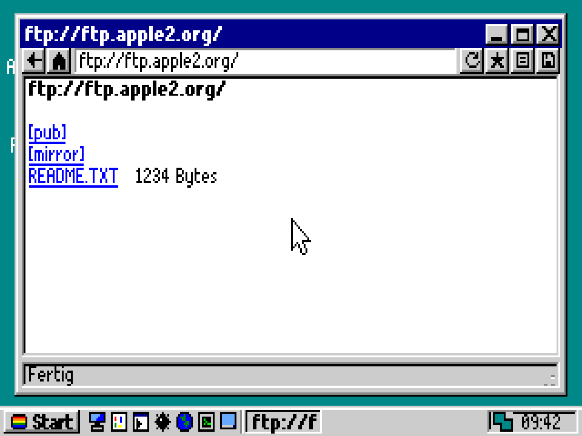

`ftp://rechner/pfad/` zeigt ein Verzeichnis als Liste: `[Ordner]`, Dateien mit Größe und `[..]` für eine
Ebene höher. Ein Klick auf eine Datei lädt sie nach `*:Downloads`. Die Anmeldung erfolgt anonym. FTP geht
mit der Uthernet II und der FujiNet.

**Bilder nach Paint:** Strg-P holt das erste Bild der Seite in Paint.

**Eingebaute Seiten**

| Seite | Inhalt |
|---|---|
| `about:start` | Startseite mit Seiten für alte Rechner (ohne https) |
| `about:lz`, `about:verlauf` | Lesezeichen, Verlauf |
| `about:wetter` | Wetter (Ort eintippen, er wird gemerkt; Daten von wttr.in), auch Start > Programme > Internet > Wetter |
| `about:archiv` | Software-Archiv (Asimov), Dateien per Klick laden |
| `about:rss` | Nachrichten aus RSS-/Atom-Feeds |
| `about:bbs` | Mailbox-Telefonbuch fürs Terminal |
| `about:msdos` | MS-DOS-Eingabeaufforderung |
| `about:net` | Netzwerkstatus |
| `about:keys` | Tastenkürzel |
| `about:update` | nach neuer Version suchen (GitHub; braucht https, also CoGS, FujiNet oder Proxy) |
| `about:cddb` | Server für CD-Titelnamen |

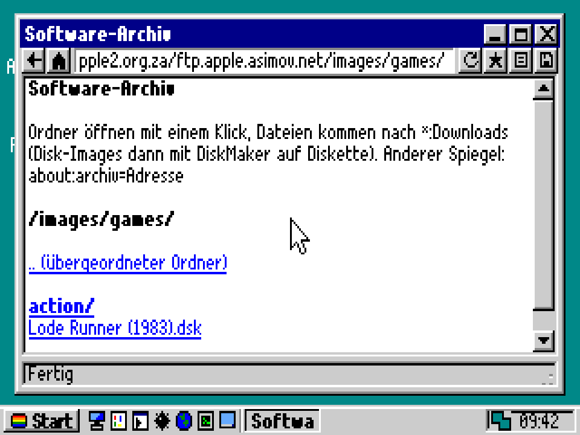 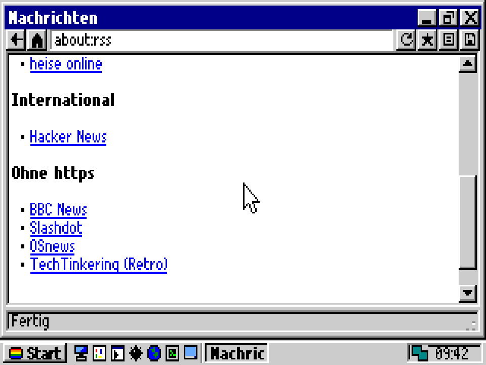

**Tasten:** Pfeiltasten und Leertaste blättern, Pfeil links geht zurück, Strg-R lädt neu, Esc bricht das
Laden ab bzw. schließt das Fenster.

---

## 7. Terminal, Telnet und SSH

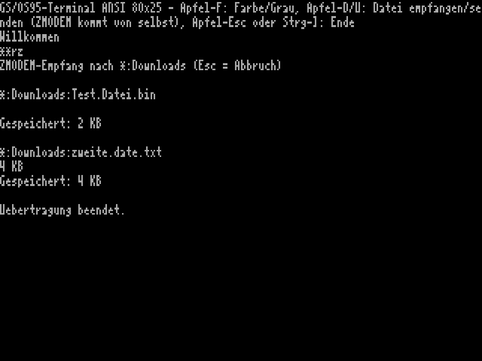

Start > Programme > Internet > Terminal öffnet das Mailbox-Telefonbuch (bis 8 Einträge, oder
„Direkt verbinden“). `telnet://rechner:port` geht auch direkt in der Adresszeile.

- **Vollbild mit 80 × 25 Zeichen**, PC-Zeichensatz (CP437) und ANSI-Farben. Apfel-F wechselt zwischen
  Farbe (320er Modus) und scharfen Graustufen (640er Modus).
- ANSI/VT100-Steuerfolgen werden ausgewertet. Als Terminaltyp meldet GS/OS95 „ANSI“ mit 80 × 25 Zeichen.
- **Dateiübertragung:** ZMODEM-Downloads starten von selbst. Apfel-D empfängt mit XMODEM oder YMODEM,
  Apfel-U sendet mit XMODEM. Alles landet in `*:Downloads`.
- **Beenden:** Apfel-Esc oder Strg-].

**SSH** (nur mit FujiNet): `ssh://benutzer@rechner`. Danach fragt das Terminal nach dem Passwort.

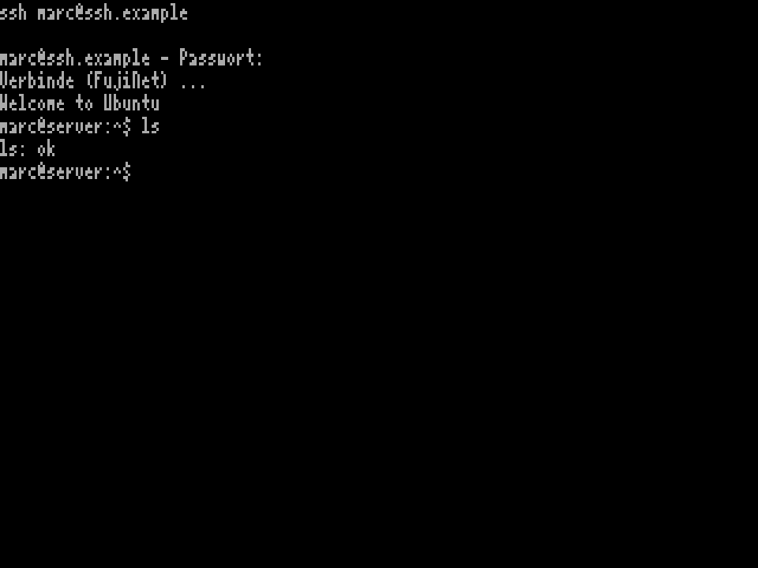

**IRC:** `irc://rechner/kanal` läuft im Browserfenster. Die Adresszeile ist die Eingabezeile, `/msg`,
`/join`, `/nick` und `/quit` funktionieren.

---

## 8. MS-DOS-Eingabeaufforderung

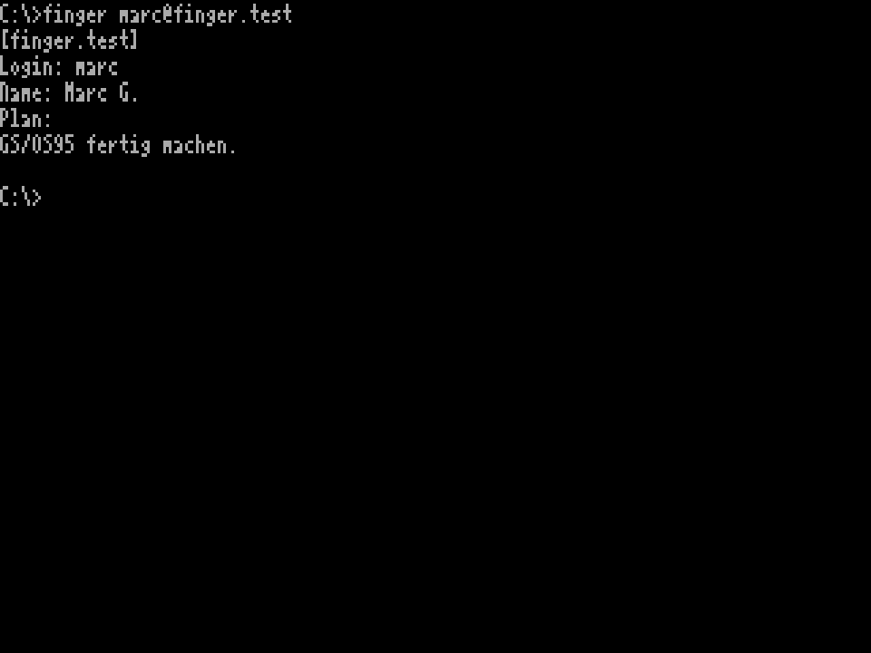

Start > Programme > Werkzeuge > MS-DOS. Vollbild wie unter DOS; Laufwerk C: ist das Startlaufwerk.

| Befehl | Wirkung |
|---|---|
| `DIR`, `CD`, `CD ..`, `CD \` | Inhalt zeigen, Ordner wechseln |
| `TYPE datei` | Text seitenweise zeigen (Esc stoppt) |
| `CLS`, `COLOR 1E` | Bildschirm löschen, Farben |
| `DATE`, `TIME`, `MEM`, `VER`, `ECHO` | wie unter DOS |
| `PING rechner` | misst den Verbindungsaufbau (TCP Port 80) |
| `NSLOOKUP rechner` | Namen auflösen |
| `IPCONFIG`, `WINIPCFG` | Netzwerkkarte, Adressen, DHCP, MAC |
| `FINGER benutzer@rechner` | Finger-Abfrage |
| `HELP`, `EXIT` | Hilfe, zurück zum Schreibtisch |

Pfeil hoch holt den letzten Befehl zurück. Die Eingabeaufforderung verändert keine Dateien: `DEL`,
`COPY`, `FORMAT` und ähnliche Befehle sind harmlos.

---

## 9. Paint

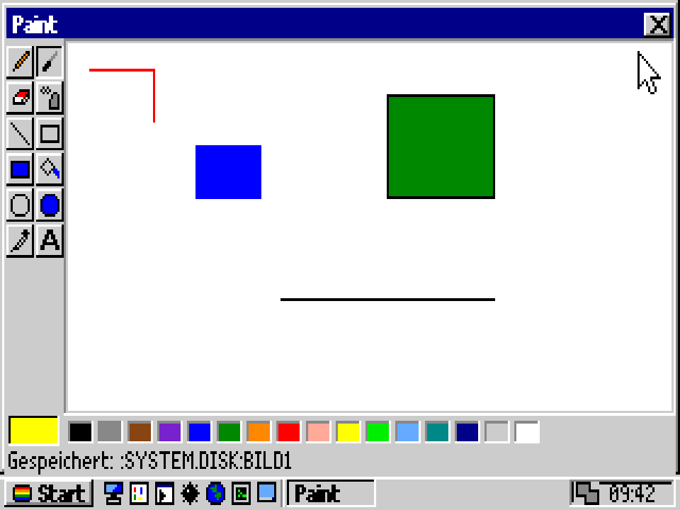

Start > Programme > Werkzeuge > Paint. Bild 320 × 200 mit den 16 Farben des Schreibtischs.

**Werkzeuge:** Stift, Pinsel, Radierer, Sprühdose, Linie, Rechteck, gefülltes Rechteck, Füllen,
Ellipse, gefüllte Ellipse, Pipette (danach geht es zum vorigen Werkzeug zurück) und Text.

**Text:** Ins Bild klicken und tippen. Return oder ein Klick setzt den Text, Esc verwirft ihn.

| Taste | Wirkung |
|---|---|
| S | Speichern als $C1-Bild; neue Bilder heißen `*:BILD1`, `*:BILD2` … |
| Z | Rückgängig |
| N | Neues Bild |
| Pfeiltasten | Ausschnitt verschieben |
| Esc | Schließen; bei ungespeichertem Bild erst nachfragen, ein zweites Esc verwirft es |

Bilder öffnen: im Bildbetrachter die Taste B drücken, oder im Browser Strg-P für das Bild einer Webseite.

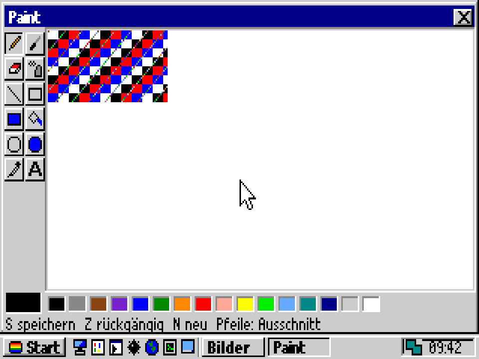

---

## 10. Weitere Programme

| Programm | Bedienung |
|---|---|
| **Editor** | Textdateien bis 32000 Zeichen, Umbruch am Fensterrand, Umlaute. Pfeile, Apfel-Pfeile (Zeilenanfang/-ende, Seite), Wahl-Pfeile (Wort), Delete, Strg-D (rechts löschen), Klick setzt den Cursor. Apfel-S speichert (neue Texte fragen nach dem Pfad), Apfel-N neu, Esc schließt (fragt bei Änderungen). Gespeichert wird mit CR als Zeilenende |
| **Datum/Uhrzeit** | Klick auf die Uhr: Monatskalender (heute blau), Zifferblatt, Datum ausgeschrieben. Pfeile blättern Monate, Pfeil hoch/runter Jahre, H springt zu heute, „Ändern…“ stellt die Uhr |
| **Rechner** | 16 Stellen. Ziffern, `+ - * /`, Return oder `=`, `%`. W Wurzel, Q Quadrat, R 1/x, ! Fakultät, P Pi, N Vorzeichen, Speichertasten. Esc löscht, zweimal Esc schließt |
| **Solitär** | Klondike wie unter Windows. Karten ziehen, Doppelklick legt ab, Klick auf den Talon zieht. N neues Spiel, U rückgängig, D eine/drei Karten, A alles ablegen |
| **Minesweeper** | 9 × 9 Felder, 10 Minen. Wahltaste-Klick setzt eine Fahne. Smiley = neues Spiel, die Bestzeit wird gemerkt |
| **CD-Wiedergabe** | Audio-CDs in SCSI-CD-Laufwerken (AppleCD SC/150/300/600 und SCSI-2-Laufwerke). Leertaste Wiedergabe/Pause, Pfeile Titel, S Stopp, E Auswerfen, L nächstes Laufwerk, I Titelnamen aus dem Internet (CDDB). Eine neu eingelegte CD spielt von selbst |
| **Nachrichten** | RSS-/Atom-Feeds als Seite (`about:rss`) |
| **Software-Archiv** | Asimov-Archiv durchsuchen und herunterladen (`about:archiv`) |
| **Wetter** | Vorhersage für einen Ort (`about:wetter`) |

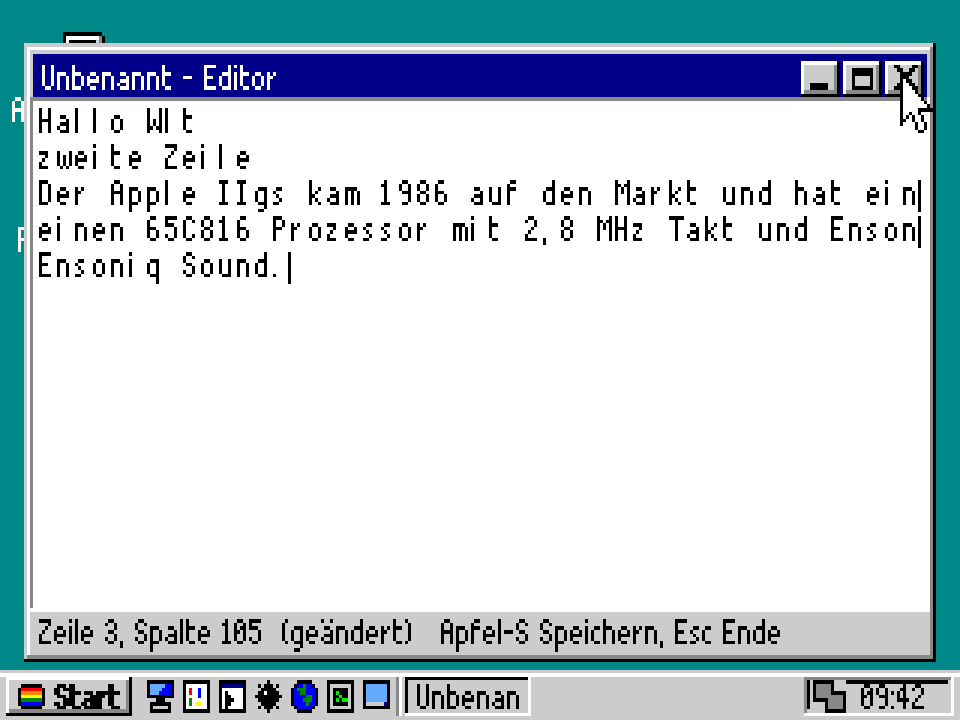 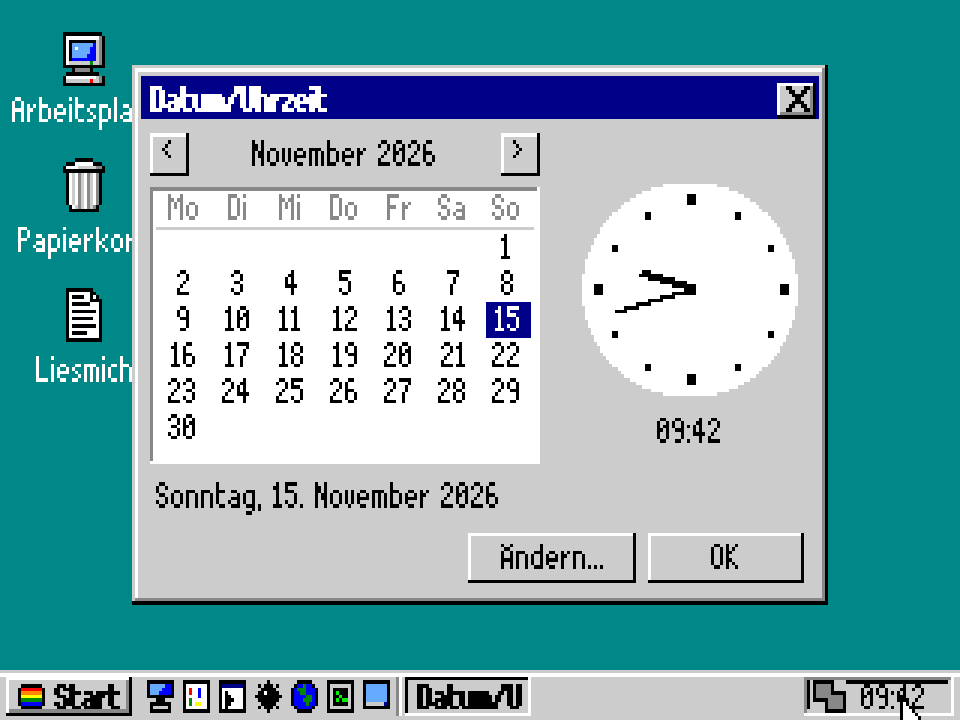 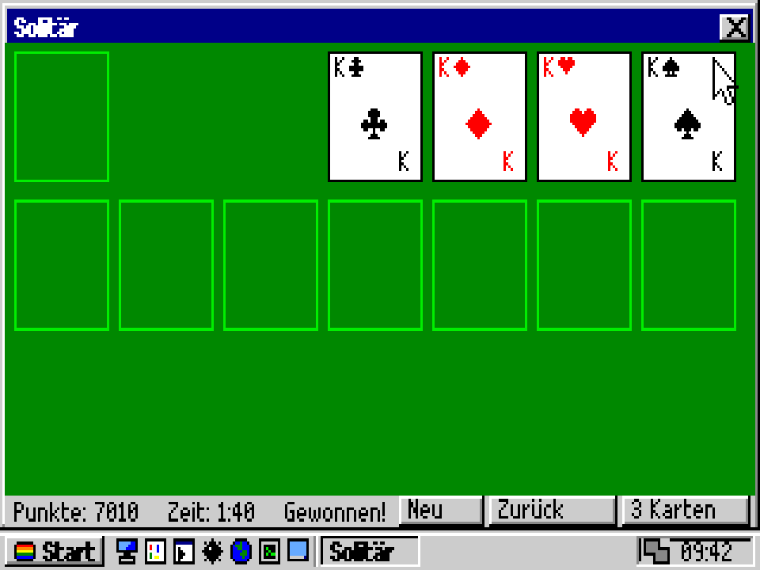 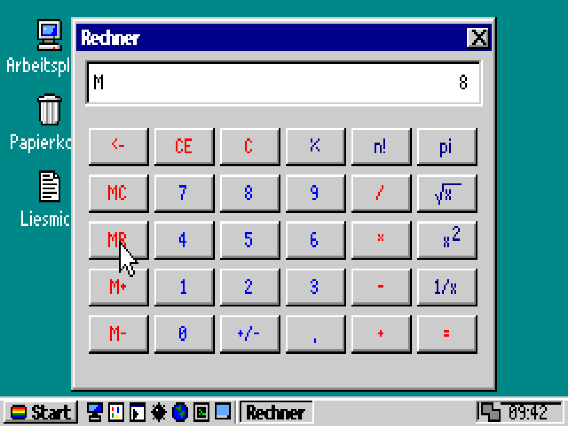 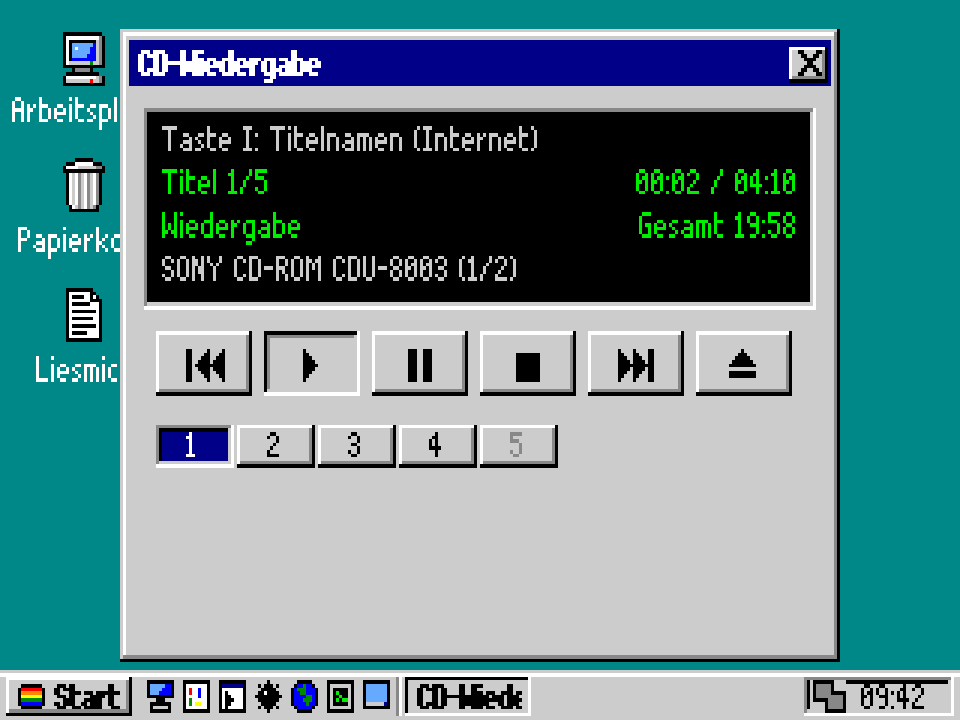

---

## 11. Programme anderer Hersteller

Die Systemerweiterung **GSOS95.INIT** (in `*:System:System.Setup`) gibt auch anderen GS/OS-Programmen
den Win95-Stil:

- **Titelleisten:** Titel links, Maximieren- und X-Knopf rechts, inaktive Fenster grau.
- **Öffnen- und Sichern-Dialoge** im Explorer-Stil: „Suchen in“, „Eine Ebene höher“, „Neuer Ordner“.
  Mit gedrückter Wahltaste erscheint Apples Originaldialog.
- **Knöpfe und Ankreuzfelder** im Win95-Stil.

Abschalten: die Datei aus System.Setup entfernen und neu starten.

**Schreibtischzubehör** (Start > Zubehör) öffnet sich in Fenstern mit Win95-Titelleiste. Tasten gehen
an das zuletzt angeklickte Zubehör, Esc schließt es.

**Zum GS/OS-Modus:** Beenden > F wechselt zu Apples Finder.

---

## 12. Tastenkürzel

| Wo | Taste | Wirkung |
|---|---|---|
| überall | Tab | Startmenü |
| | Apfel-Tab | nächstes Fenster |
| | Esc | Fenster, Menü oder Dialog schließen |
| | Wahl-Apfel-C / Strg-Apfel-C | Bluescreen (Boss-Taste) |
| Explorer | Return / Apfel-Pfeil runter | öffnen |
| | Delete / Apfel-Pfeil hoch | eine Ebene höher |
| | Strg-N / E / D / P | neuer Ordner / umbenennen / löschen / Eigenschaften |
| | Strg-X / C / V / A | ausschneiden / kopieren / einfügen / alles |
| | Strg-R / Strg-L | aktualisieren / auswerfen |
| Textfelder | Wahl-Pfeil | wortweise |
| | Apfel-Pfeil, Strg-A / Strg-E | Anfang / Ende |
| Editor | Apfel-S / Apfel-N / Esc | speichern / neu / schließen |
| | Apfel-Pfeil, Wahl-Pfeil, Strg-D | Zeile/Seite, Wort, rechts löschen |
| Browser | Strg-R / D / B / S / P | neu laden / merken / Lesezeichen / speichern / Bild nach Paint |
| | Pfeil links | zurück |
| Terminal | Apfel-F | Farbe/Grau |
| | Apfel-D / Apfel-U | empfangen / senden |
| | Apfel-Esc, Strg-] | Verbindung beenden |

Die vollständige Liste zeigt Start > Hilfe.

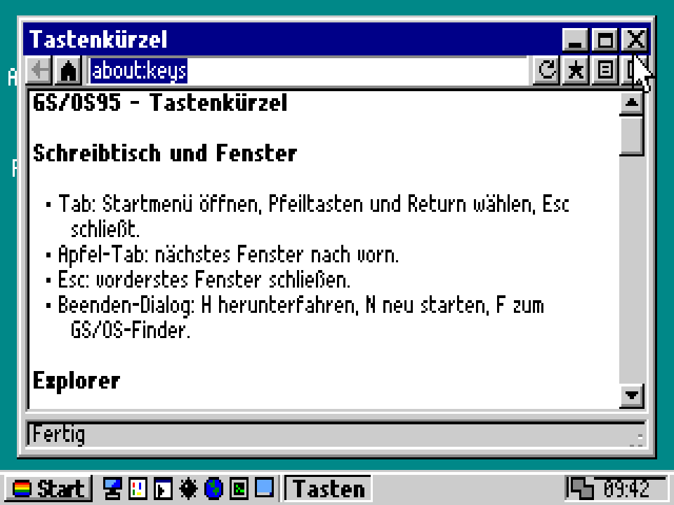

---

## 13. Dateien von GS/OS95

| Datei | Inhalt |
|---|---|
| `*:System:GSOS95` | das Programm |
| `*:System:Start.GS.OS`, `*:System:Boot95`, `*:System:GSOS95.SPL` | Startbild und Ladebalken |
| `*:System:System.Setup:GSOS95.INIT` | Win95-Stil für alle Programme |
| `*:System:GSOS95.PREFS` | Einstellungen, Fenster, Verknüpfungen |
| `*:System:GSOS95.NET` | Netzwerk, Telefonbuch, Startseite |
| `*:System:GSOS95.LZ` | Lesezeichen und Verlauf |
| `*:System:GSOS95.BIN` | Herkunft der Dateien im Papierkorb |
| `*:Downloads` | heruntergeladene Dateien |

---

## 14. Bekannte Grenzen und Tipps

- **Browser:** kein JavaScript, kein CSS, keine JPEG/PNG-Bilder. Seiten für alte Rechner
  (FrogFind, 68k.news, wiby.me) funktionieren am besten.
- **https** braucht eine CoGS oder FujiNet, sonst einen Proxy. **SSH** gibt es nur mit der FujiNet.
- **FTP** geht nur mit der Uthernet II oder der FujiNet.
- **Andere Programme:** Optionsfelder, Rollbalken und Menüs behalten Apples Aussehen.
- **5,25"-Laufwerke** werden erst beim Öffnen gelesen; ein leeres Laufwerk braucht etwa 20 Sekunden.
- **Speicher:** Browser und Paint holen sich bei Bedarf zusätzlichen Speicher (der Browser eine ganze
  64-KB-Bank). Mehr RAM im IIgs schadet also nicht.
- **Ohne Erweiterungen starten:** Shift beim Start gedrückt halten.

Viel Spaß mit GS/OS95!
