# GS/OS95 – User Manual

*Version 2.18 · Build 2.1.47 · Created by Marc Golombeck*
*Deutsche Fassung: [Handbuch.md](Handbuch.md)*

GS/OS95 is a Windows 95 style desktop for the Apple IIgs. It replaces the GS/OS Finder and brings a
Start menu, taskbar, Explorer, Recycle Bin, a web browser, a terminal and a handful of small programs.

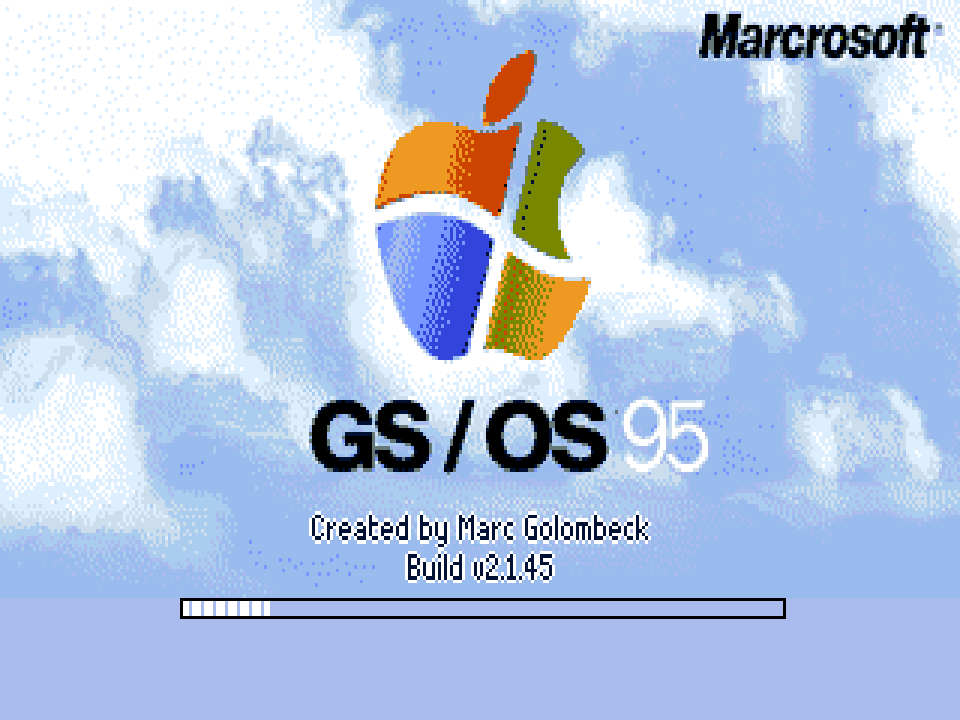

> The screenshots show the German user interface. Switch to English in Settings (the "Deutsch"/"English" icon).

---

## Contents

1. [Installing and starting](#1-installing-and-starting)
2. [The desktop](#2-the-desktop)
3. [Explorer: files and folders](#3-explorer-files-and-folders)
4. [Settings](#4-settings)
5. [Setting up the network](#5-setting-up-the-network)
6. [Internet (web browser)](#6-internet-web-browser)
7. [Terminal, Telnet and SSH](#7-terminal-telnet-and-ssh)
8. [MS-DOS prompt](#8-ms-dos-prompt)
9. [Paint](#9-paint)
10. [More programs](#10-more-programs)
11. [Other applications](#11-other-applications)
12. [Keyboard shortcuts](#12-keyboard-shortcuts)
13. [GS/OS95 files](#13-gsos95-files)
14. [Known limits and tips](#14-known-limits-and-tips)

---

## 1. Installing and starting

**What you need**

- An Apple IIgs, or an emulator such as GSSquared, KEGS, GSplus or MAME. Development and testing used
  GSSquared with ROM 3.
- The hard disk image `GSOS95_v2147_System.hdv` (32 MB, ProDOS) from the `image/` folder.

**Setting up**

- **Emulator:** mount the image as the boot drive (slot 7, drive 1).
- **Real IIgs:** copy the image to a BlueSCSI, CFFA3000, MicroDrive or similar card and boot from it.

Do not modify the image from outside while it is mounted in a running emulator. Doing so can damage the
file system.

**Start-up**

Right after power-on the boot screen with its progress bar appears. GS/OS loads its drivers and
extensions, then GS/OS95 takes over. The bar runs to the end and the desktop appears. Folder windows
that were open last time open again.

A short start-up chime plays after power-on. You can switch it off in Settings > Sound.

**Language:** German or English. Switch it in Settings with the "Deutsch"/"English" icon.

---

## 2. The desktop

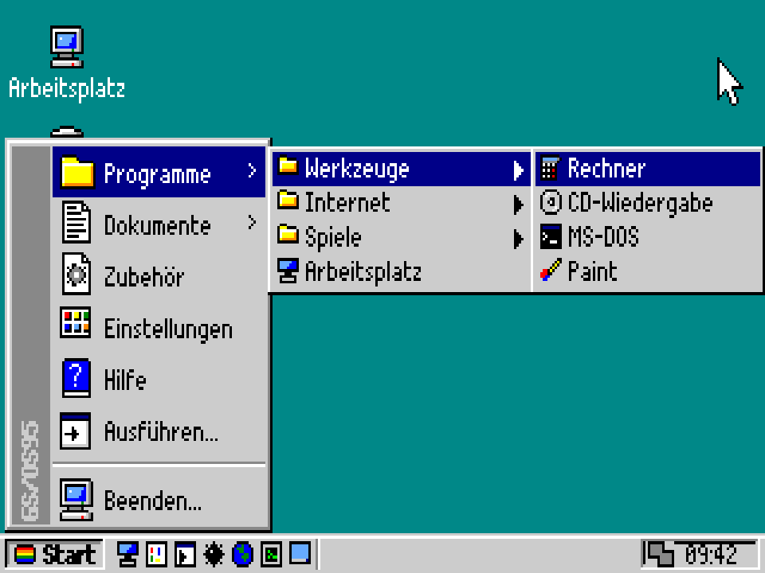

**Desktop icons**

- **My Computer:** all drives.
- **Recycle Bin:** deleted files, which you can restore.
- **Readme:** a short introduction.
- **Shortcuts:** up to six of your own (see below).

**Taskbar**

- **Start button:** opens the Start menu (the Tab key does too).
- **Quick-launch bar:** My Computer, Settings, Run, Minesweeper, Internet, Terminal and Show Desktop.
  Show Desktop minimizes all windows; a second click brings them back.
- **Window buttons:** one per open window. A click brings the window to the front. A click on the active
  window's button minimizes it.
- **Network icon:** blue means connected, gray means not connected. A click opens the network settings.
- **Clock:** a click opens Date/Time with a month calendar and a clock face (see section 10).

**Start menu**

| Item | Contents |
|---|---|
| Programs | Tools (Calculator, CD Player, MS-DOS, Paint, Notepad), Internet (Internet, Terminal, Software Archive, News, Weather), Games (Minesweeper, Solitaire), My Computer and your own programs |
| Documents | the last 8 files you opened |
| Accessories | all desk accessories (NDAs) in `*:System:Desk.Accs` |
| Settings | the control panel |
| Help | list of keyboard shortcuts (about:keys) |
| Run… | start a program or open a file by its path |
| Shut Down… | shut down (H), restart (N) or switch to GS/OS mode (F) |

The Start menu works fully from the keyboard: arrow keys, Return and Esc.

**Your own programs and shortcuts**

Option-click a file to open its context menu. **"Add to Start menu"** puts the file under Programs; a
second time removes it. **"Send to desktop"** creates a shortcut. Delete removes a selected shortcut; the
file itself stays.

**Windows**

Drag a window by its title bar. Resize it with the grip in the bottom-right corner. Maximize it with the
button or by double-clicking the title bar. Windows can also be minimized and closed (X or Esc).
Apple-Tab brings the next window to the front.

**Screen saver**

Two savers, a starfield and Mystify-style lines, take turns. Set the delay in Settings > Display >
"Saver (min)" to 1–15 minutes; 0 turns it off. It is off by default.

**Boss key**

Option-Apple-C (or Ctrl-Apple-C) shows a convincing Windows 95 blue screen. Any key brings you back,
and nothing actually crashes.

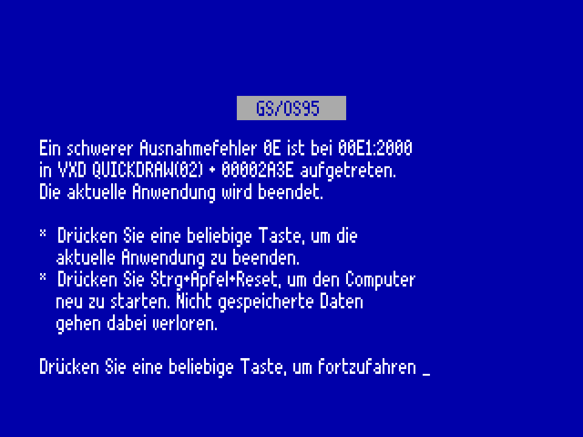

---

## 3. Explorer: files and folders

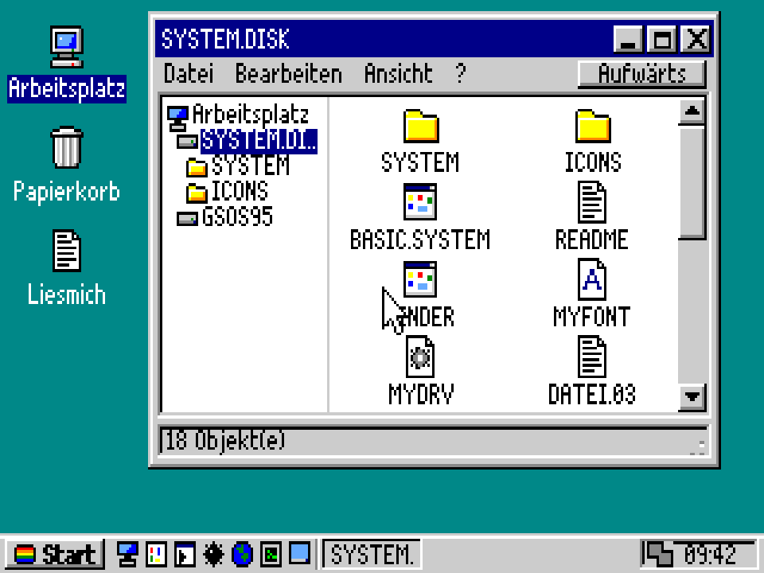

Double-click **My Computer** to see the drives, then double-click a drive or folder to open it. Up to
six Explorer windows can be open at once.

**View menu**

- **Icons or Details:** Details shows name, size and type.
- **Sort** by name, size or type. Folders always come first.
- **Folder tree** on the left shows the path, sibling folders and drives. A click goes there.

GS/OS95 remembers the view and sort order.

**Selecting:** click to select. Shift-click or Apple-click adds items. Ctrl-A selects everything.

**Editing**

| Action | How |
|---|---|
| Copy / cut / paste | Ctrl-C / Ctrl-X / Ctrl-V, with a progress dialog and Cancel |
| Drag and drop | onto a folder, another window, a drive or the Recycle Bin. Same drive = move, other drive = copy |
| New folder | Ctrl-N |
| Rename | Ctrl-E |
| Delete (to the Recycle Bin) | Ctrl-D |
| Properties | Ctrl-P |
| Duplicate | File > Duplicate (creates COPY.name) |
| Find | File > Find… (folder and its subfolders) |
| Refresh | Ctrl-R |
| Eject disk | Ctrl-L |

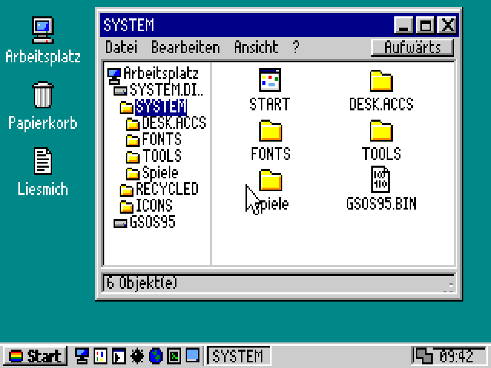

**Properties**

Change the file type and auxiliary type here (in hexadecimal) and set the lock. Text files show their
first lines and pictures show a colour thumbnail.

**Opening files**

- **Programs** (S16, SYS, EXE) start with a double-click. When they quit, you are back in GS/OS95.
- **Text files** (TXT, SRC) open in Notepad (section 10).
- **Documents** open with their application, as set in the icon files in `*:Icons`.
- **BASIC programs** run through BASIC.SYSTEM.
- **Pictures** ($C1, packed $C0/0001, Apple Preferred $C0/0002) fill the screen. Press B to open the
  picture in Paint.
- **Sound files** ($D8) play.

**Recycle Bin**

Deleted items go to the Recycle Bin. "Restore" (File menu or Ctrl-E) puts them back where they came
from. "Empty Recycle Bin" shows its progress. Hold Option to empty it without being asked.

**Drives**

- **Volumes** can be renamed, erased and copied in My Computer. To copy, copy the drive, select the
  target and paste.
- **Unformatted disks** are recognized and offered for formatting.
- **5.25" drives** are only read when you open them, because an empty drive takes a long time.
- **Drives on the desktop:** optionally, the drives appear on the right of the desktop like on a Mac
  (Settings > Display > "Show drives").

**System folder**

Drag control panels, desk accessories, fonts, drivers, tools or extensions onto the System folder.
GS/OS95 offers to sort them into the right subfolders.

---

## 4. Settings

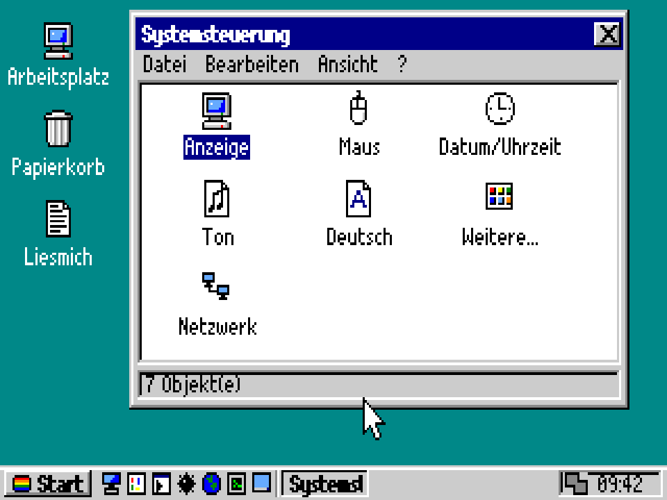

Open Start > Settings or use the quick-launch icon.

| Icon | Settings |
|---|---|
| Display | desktop and border colour, pattern (0–4), screen saver (minutes), drives on the desktop |
| Mouse | double-click speed, fast mouse |
| Date/Time | sets the system clock |
| Sound | volume, pitch, start-up chime |
| Deutsch / English | user interface language |
| Network | network card, addresses, proxy (see section 5) |
| More… | Apple's control panels (for third-party control panels) |

The arrow keys, Return and Esc work in the control panel too. Values are kept in Battery RAM and in
`*:System:GSOS95.PREFS`.

---

## 5. Setting up the network

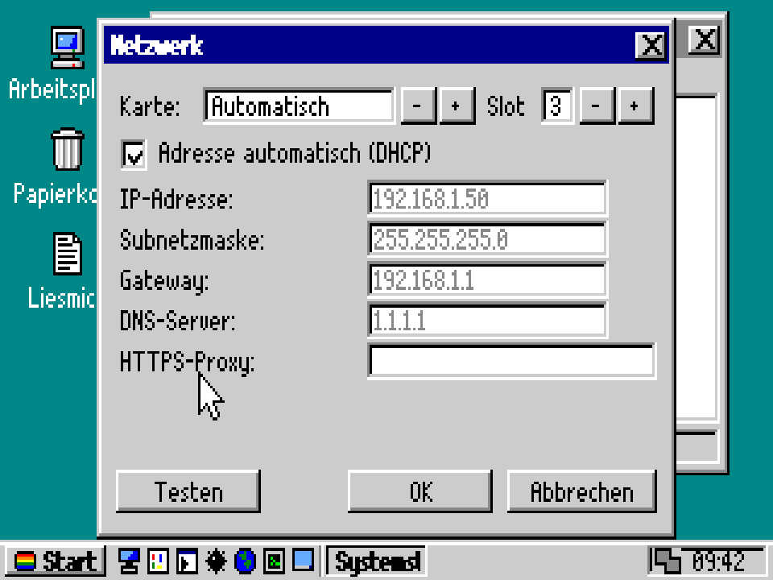

Open Settings > Network and choose the card with the − and + buttons:

| Card | Notes |
|---|---|
| **Automatic** | tries CoGS, FujiNet, Marinetti and Uthernet II in turn |
| **Uthernet II** | driven directly, no Marinetti needed. Set the slot (default 3), then DHCP or fixed addresses. https only through a proxy |
| **CoGS** | brings Wi-Fi/Ethernet, DHCP, DNS and **TLS** itself, so https works directly |
| **FujiNet** | on the SmartPort. Handles https, **SSH** and **FTP** itself |
| **Marinetti** | uses the Marinetti 3.0 TCP/IP stack (installed on the image), so any card with a link layer works: Uthernet I, LANceGS, SLIP/PPP … |
| **Wi-Fi modem** | serial port (WiModem232, Zimodem, WiFi232), 2400–57600 baud |

"Test" starts the card and queries the name server. If DHCP fails, the fixed addresses are used.

**https without CoGS or FujiNet:** use a proxy on your network that does the encryption (e.g. WebOne or
Macproxy). Enter it in the "HTTPS proxy" field, or type `about:proxy=192.168.1.10:8080` in the browser.

**Clock from the Internet:** on the first page load, GS/OS95 sets the IIgs clock from a time server. Set
the time zone in the browser:

- `about:tz=+1eu` – Central Europe with daylight saving time (default)
- `about:tz=-5us` – US East Coast with daylight saving time
- `about:tz=+0` – no daylight saving time
- `about:tz=off` – no time sync

`about:net` shows the network status and runs a connection test.

**GSSquared emulator:** add a card with `card = "uthernet2"`. DHCP does not answer there, but the fixed
addresses work.

---

## 6. Internet (web browser)

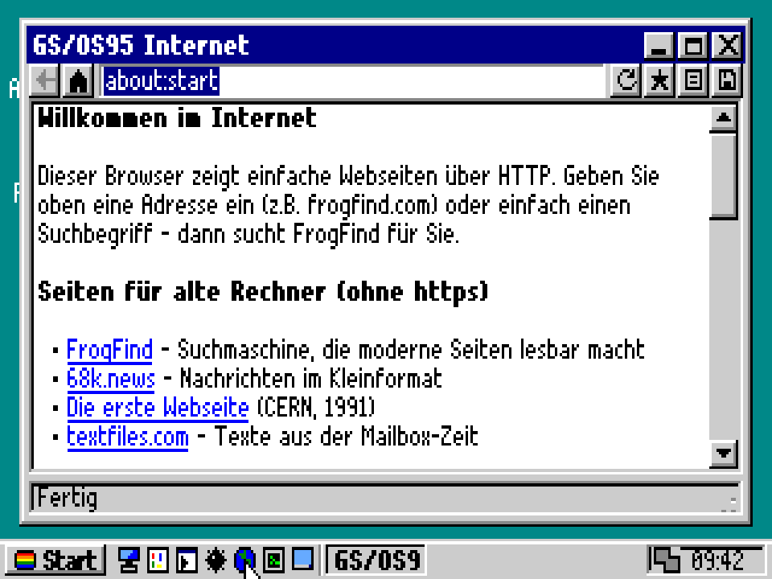

Open Start > Programs > Internet, or click the globe in the quick-launch bar.

**Address bar:** type an address (e.g. `frogfind.com`) or a search term and press Return. On the left are
Back and Home; on the right are Reload, Bookmark (star), Bookmarks (list) and Save (disk).

**Features**

- HTTP with redirects and cookies. Pages of any size load; up to 16 KB of text is shown.
- Headings, lists, tables, quotes and preformatted text. UTF-8, Latin-1 and Windows-1252 characters.
- **GIF images** in pages (up to 8). Click one to see it full size; Esc skips loading.
- **Forms:** text fields, check boxes, pop-ups and buttons; GET and POST.
- **Downloads:** anything that is not a page goes to `*:Downloads`. Ctrl-S saves the current page.
- **Protocols:** `http://`, `https://`, `gopher://`, `ftp://`, `telnet://`, `ssh://`, `irc://`.

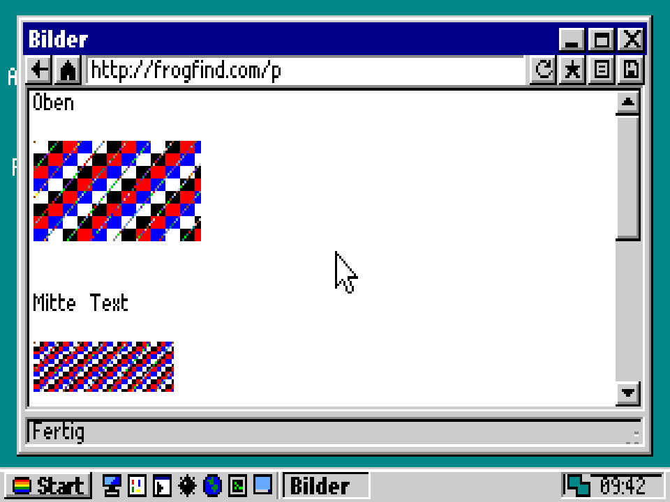

**Bookmarks, history and search**

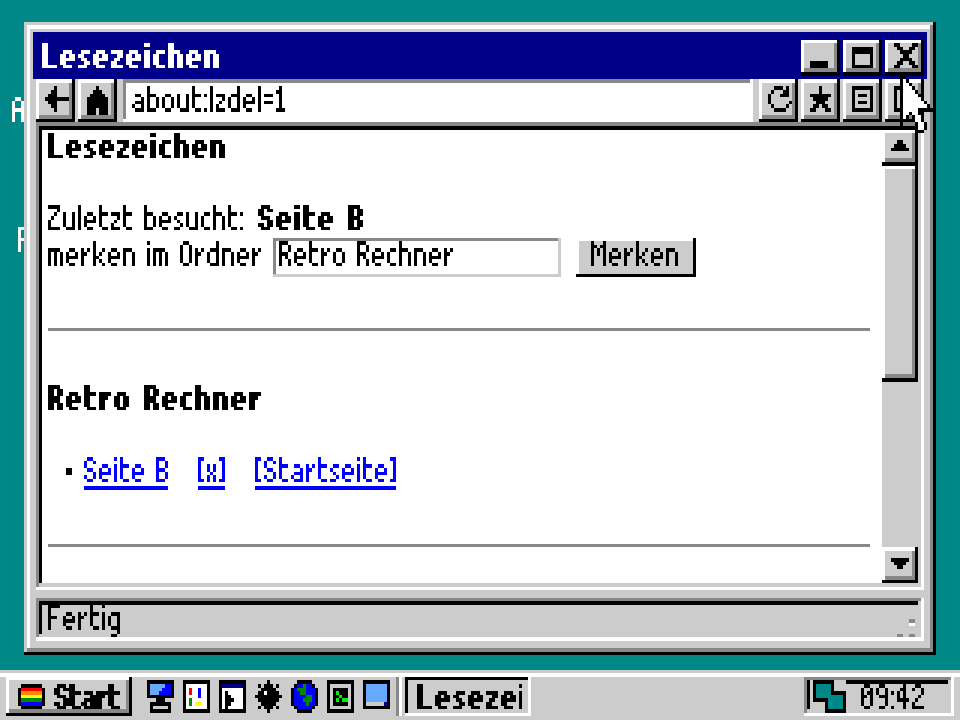

- **Ctrl-D** (or the star) bookmarks the page and **Ctrl-B** shows your bookmarks (`about:lz`). They can
  be sorted into folders; `[x]` deletes one and `[Home]` makes it the home page.
- **History:** the last 20 pages, at `about:verlauf`.
- **Search engine:** choose FrogFind, wiby.me or DuckDuckGo on the bookmarks page.

**FTP**

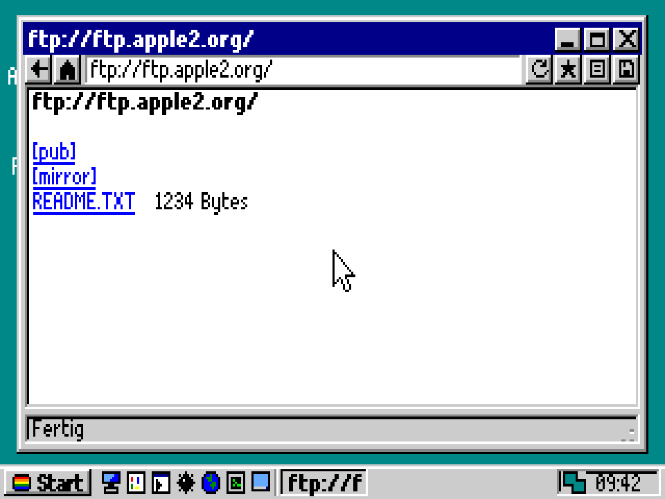

`ftp://host/path/` lists a directory: `[folders]`, files with their size, and `[..]` to go up. Click a
file to download it to `*:Downloads`. The login is anonymous. FTP works with the Uthernet II and the
FujiNet.

**Pictures to Paint:** Ctrl-P opens the page's first picture in Paint.

**Built-in pages**

| Page | Contents |
|---|---|
| `about:start` | start page with sites for vintage computers (no https needed) |
| `about:lz`, `about:verlauf` | bookmarks, history |
| `about:wetter` | weather forecast for a town (remembered; data from wttr.in), also Start > Programs > Internet > Weather |
| `about:archiv` | software archive (Asimov); click a file to download it |
| `about:rss` | news from RSS/Atom feeds |
| `about:bbs` | BBS phone book for the terminal |
| `about:msdos` | MS-DOS prompt |
| `about:net` | network status |
| `about:keys` | keyboard shortcuts |
| `about:update` | check for a new version (GitHub; needs https, so CoGS, FujiNet or a proxy) |
| `about:cddb` | server for CD track names |

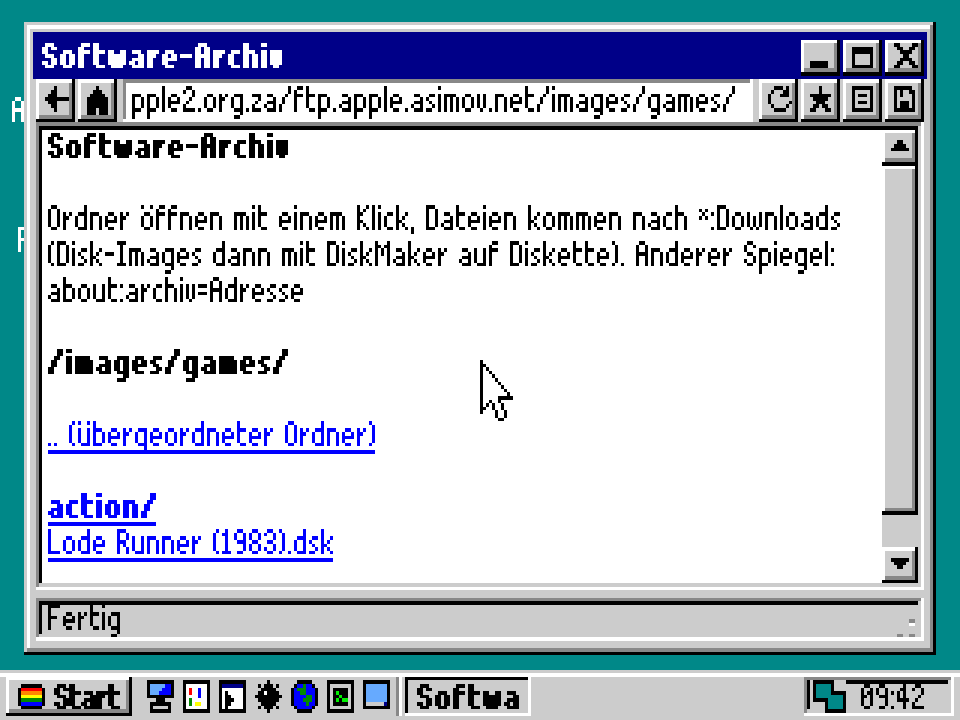 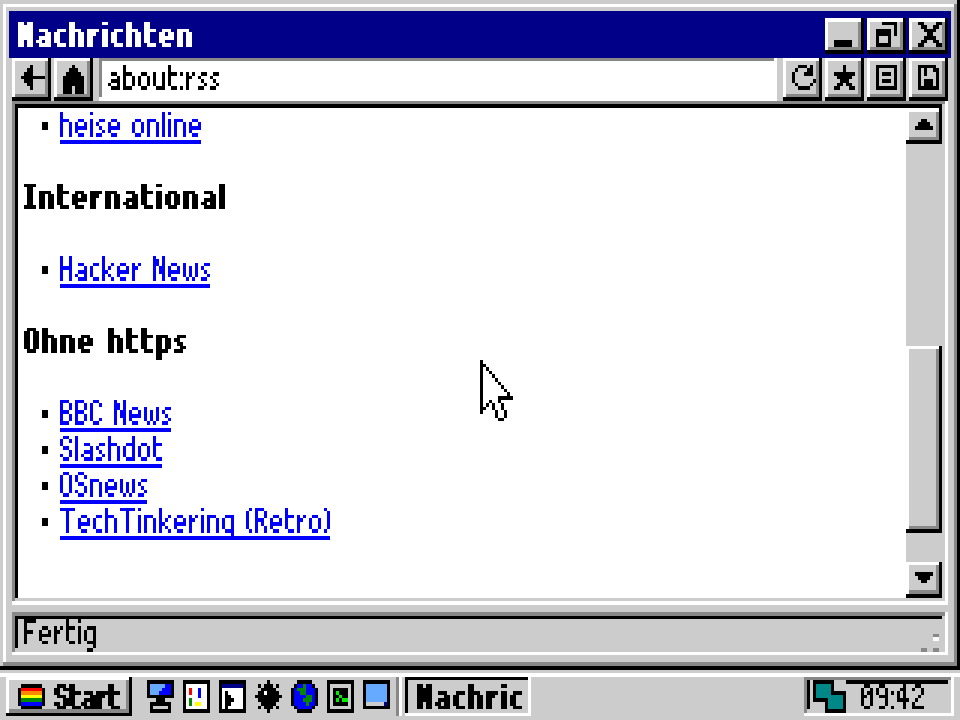

**Keys:** the arrow keys and space scroll, the left arrow goes back, Ctrl-R reloads. Esc cancels
loading or closes the window.

---

## 7. Terminal, Telnet and SSH

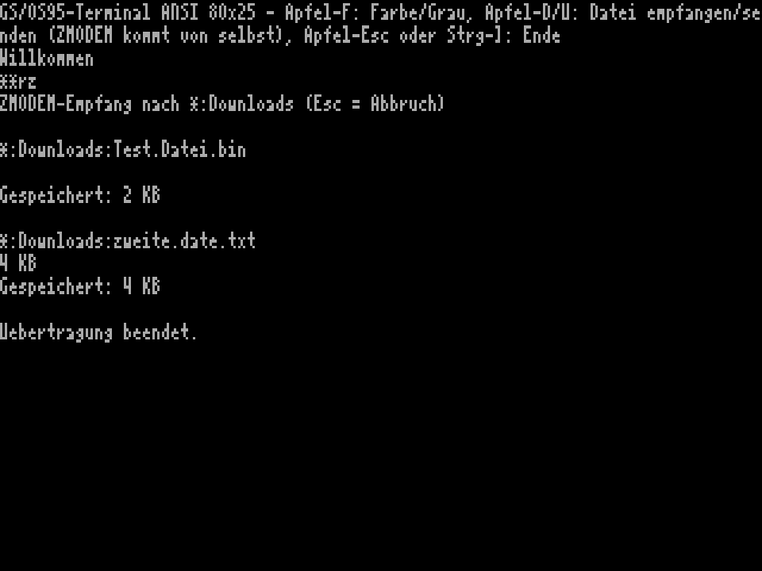

Start > Programs > Internet > Terminal opens the BBS phone book (up to 8 entries, or "connect directly").
You can also type `telnet://host:port` in the address bar.

- **Full screen** with 80 × 25 characters, the PC character set (CP437) and ANSI colours. Apple-F switches
  between colour (320 mode) and sharp grayscale (640 mode).
- **ANSI/VT100** control sequences are supported. GS/OS95 reports the terminal type "ANSI" with
  80 × 25 characters.
- **File transfer:** ZMODEM downloads start by themselves. Apple-D receives with XMODEM or YMODEM and
  Apple-U sends with XMODEM. Everything goes to `*:Downloads`.
- **Quit:** Apple-Esc or Ctrl-].

**SSH** (FujiNet only): `ssh://user@host`. The terminal then asks for the password.

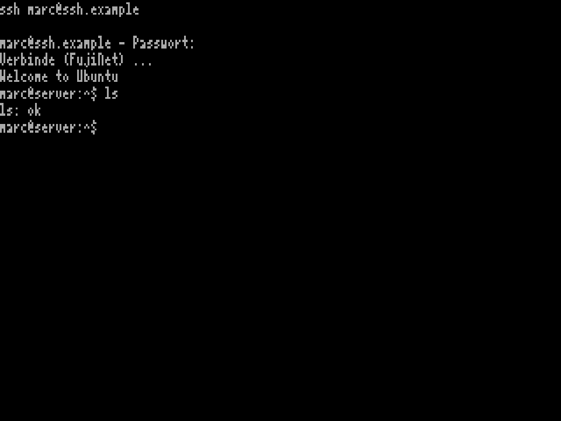

**IRC:** `irc://host/channel` runs in the browser window. The address bar is the input line, and
`/msg`, `/join`, `/nick` and `/quit` work.

---

## 8. MS-DOS prompt

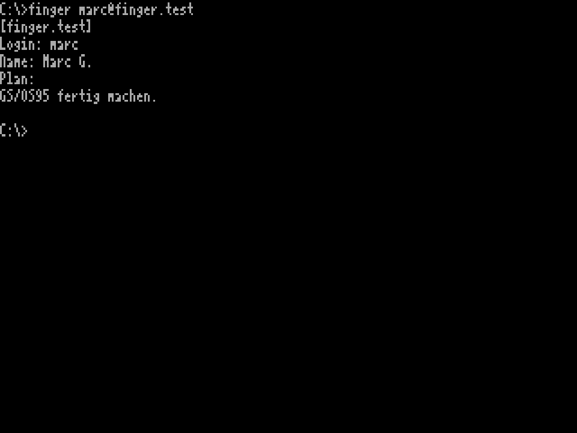

Start > Programs > Tools > MS-DOS opens a full-screen prompt like DOS. Drive C: is the boot volume.

| Command | Effect |
|---|---|
| `DIR`, `CD`, `CD ..`, `CD \` | list a folder, change folders |
| `TYPE file` | show a text file page by page (Esc stops) |
| `CLS`, `COLOR 1E` | clear the screen, set colours |
| `DATE`, `TIME`, `MEM`, `VER`, `ECHO` | as in DOS |
| `PING host` | times a connection (TCP port 80) |
| `NSLOOKUP host` | resolves a name |
| `IPCONFIG`, `WINIPCFG` | network card, addresses, DHCP, MAC |
| `FINGER user@host` | finger query |
| `HELP`, `EXIT` | help, back to the desktop |

The up arrow recalls the last command. The prompt never changes files: `DEL`, `COPY`, `FORMAT` and
similar commands are harmless.

---

## 9. Paint

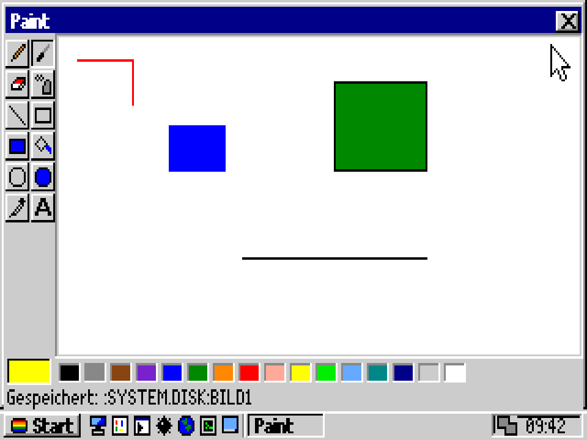

Open Start > Programs > Tools > Paint. Pictures are 320 × 200 in the 16 desktop colours.

**Tools:** pen, brush, eraser, spray can, line, rectangle, filled rectangle, fill, ellipse, filled
ellipse, colour picker (goes back to the previous tool afterwards) and text.

**Text:** click in the picture and type. Return or a click places the text, Esc throws it away.

| Key | Effect |
|---|---|
| S | save as a $C1 picture; new pictures are called `*:BILD1`, `*:BILD2` … |
| Z | undo |
| N | new picture |
| Arrow keys | move the view |
| Esc | close; if the picture is unsaved it asks first, and a second Esc discards it |

To open a picture, press B in the picture viewer. In the browser, Ctrl-P opens a web page's picture.

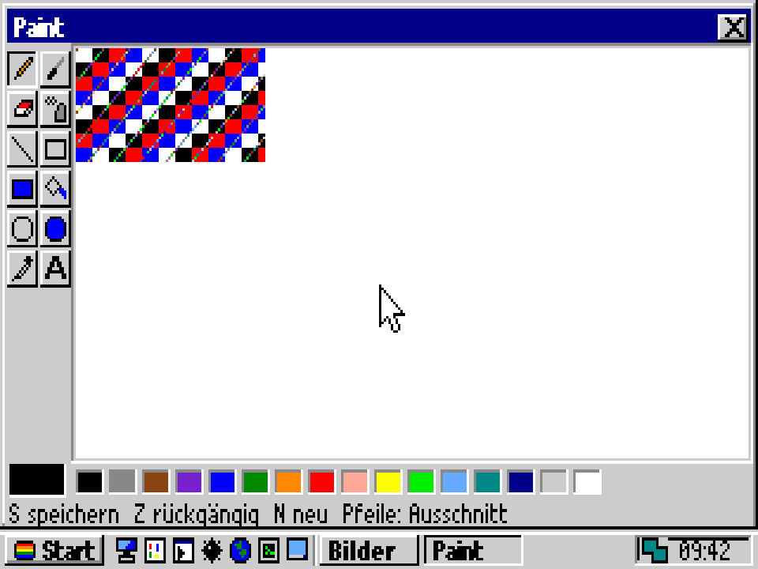

---

## 10. More programs

| Program | Use |
|---|---|
| **Notepad** | Text files up to 32,000 characters, word wrap at the window edge, umlauts. Arrows, Apple-arrows (line start/end, page), Option-arrows (word), Delete, Ctrl-D (delete right), click to place the cursor. Apple-S saves (new texts ask for a path), Apple-N new, Esc closes (asks if changed). Lines end with CR |
| **Date/Time** | Click the clock: month calendar (today in blue), clock face, full date. Arrows change month, up/down change year, H jumps to today, "Change…" sets the clock |
| **Calculator** | 16 digits. Digits, `+ - * /`, Return or `=`, `%`. W square root, Q square, R 1/x, ! factorial, P pi, N sign, memory keys. Esc clears, Esc twice closes |
| **Solitaire** | Klondike as in Windows. Drag cards, double-click sends a card to a foundation, click the stock to draw. N new game, U undo, D draw one/three, A move everything possible |
| **Minesweeper** | 9 × 9 cells, 10 mines. Option-click places a flag. The smiley starts a new game; the best time is saved |
| **CD Player** | audio CDs in SCSI CD-ROM drives (AppleCD SC/150/300/600 and SCSI-2 drives). Space play/pause, arrows change track, S stop, E eject, L next drive, I track names from the Internet (CDDB). An inserted audio CD plays by itself |
| **News** | RSS/Atom feeds as a page (`about:rss`) |
| **Software Archive** | browse and download the Asimov archive (`about:archiv`) |
| **Weather** | forecast for a town (`about:wetter`) |

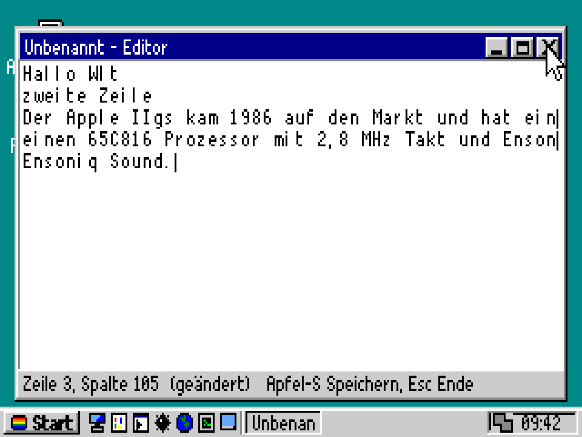 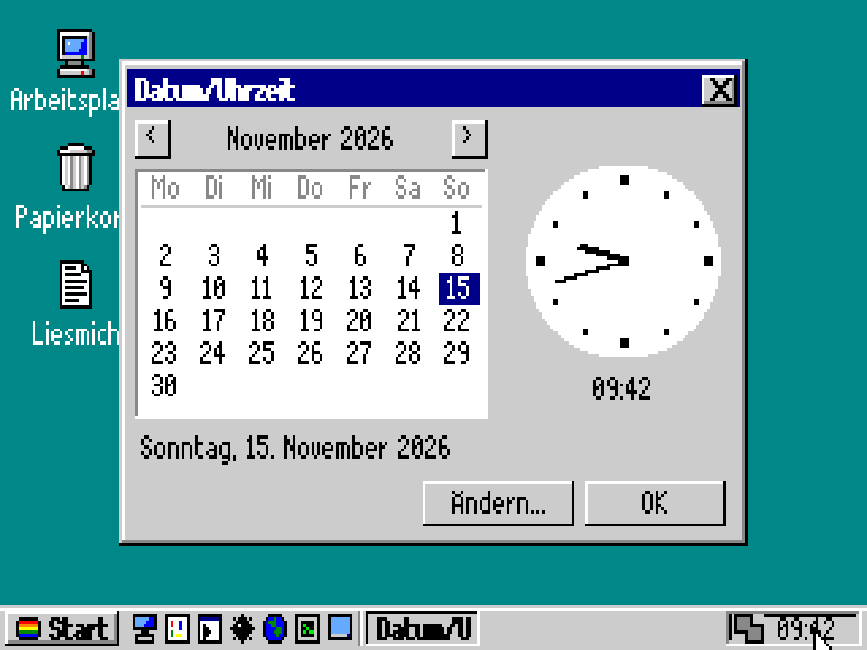 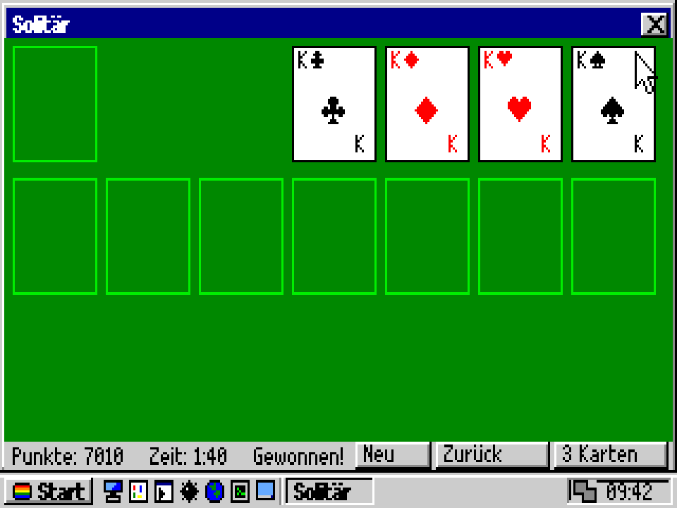 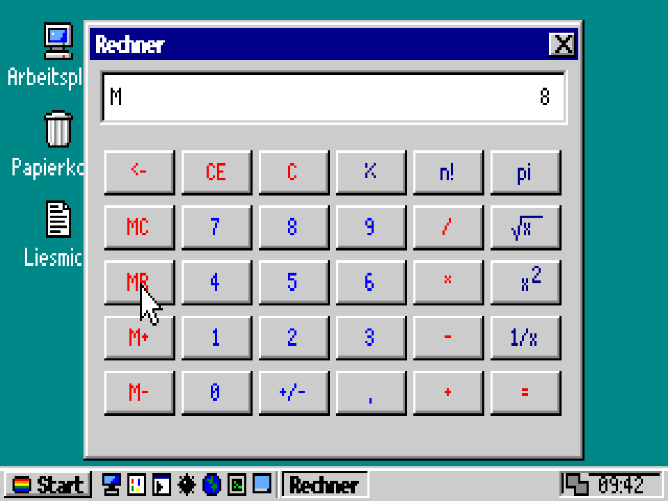 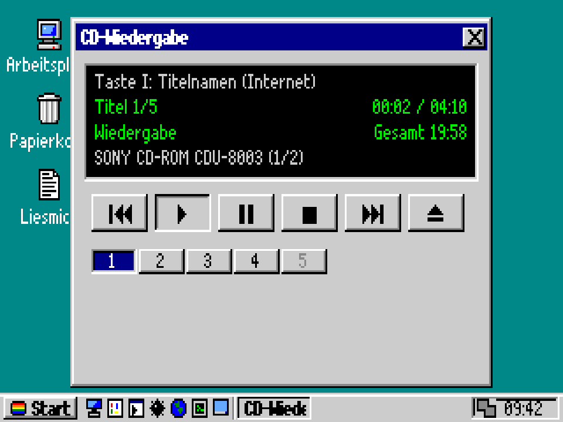

---

## 11. Other applications

The system extension **GSOS95.INIT** (in `*:System:System.Setup`) gives other GS/OS programs the Win95
look as well:

- **Title bars:** title on the left, maximize and X buttons on the right, gray when inactive.
- **Open and Save dialogs** in Explorer style, with "Look in", Up one level and New Folder. Hold Option to
  get Apple's original dialog.
- **Buttons and check boxes** in Win95 style.

To switch it off, remove the file from System.Setup and restart.

**Desk accessories** (Start > Accessories) open in windows with a Win95 title bar. Keys go to the
accessory you clicked last, and Esc closes it.

**GS/OS mode:** Shut Down > F switches to Apple's Finder.

---

## 12. Keyboard shortcuts

| Where | Key | Effect |
|---|---|---|
| everywhere | Tab | Start menu |
| | Apple-Tab | next window |
| | Esc | close window, menu or dialog |
| | Option-Apple-C / Ctrl-Apple-C | blue screen (boss key) |
| Explorer | Return / Apple-Down | open |
| | Delete / Apple-Up | up one level |
| | Ctrl-N / E / D / P | new folder / rename / delete / properties |
| | Ctrl-X / C / V / A | cut / copy / paste / select all |
| | Ctrl-R / Ctrl-L | refresh / eject |
| Text fields | Option-arrow | word by word |
| | Apple-arrow, Ctrl-A / Ctrl-E | start / end |
| Notepad | Apple-S / Apple-N / Esc | save / new / close |
| | Apple-arrow, Option-arrow, Ctrl-D | line/page, word, delete right |
| Browser | Ctrl-R / D / B / S / P | reload / bookmark / bookmarks / save / picture to Paint |
| | Left arrow | back |
| Terminal | Apple-F | colour/gray |
| | Apple-D / Apple-U | receive / send |
| | Apple-Esc, Ctrl-] | hang up |

Start > Help shows the complete list.

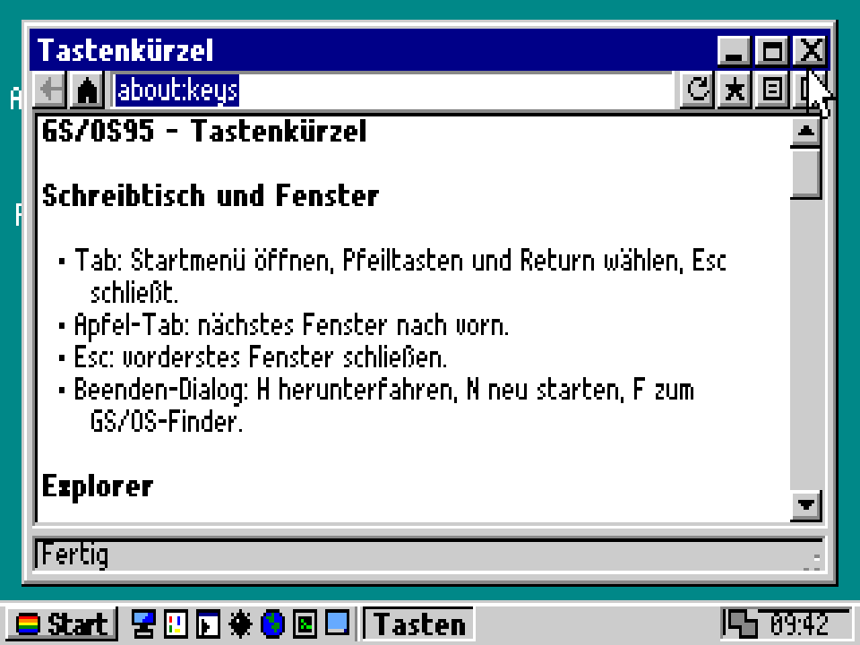

---

## 13. GS/OS95 files

| File | Contents |
|---|---|
| `*:System:GSOS95` | the program |
| `*:System:Start.GS.OS`, `*:System:Boot95`, `*:System:GSOS95.SPL` | boot screen and progress bar |
| `*:System:System.Setup:GSOS95.INIT` | Win95 look for all programs |
| `*:System:GSOS95.PREFS` | settings, windows, shortcuts |
| `*:System:GSOS95.NET` | network, phone book, home page |
| `*:System:GSOS95.LZ` | bookmarks and history |
| `*:System:GSOS95.BIN` | where Recycle Bin items came from |
| `*:Downloads` | downloaded files |

---

## 14. Known limits and tips

- **Browser:** no JavaScript, no CSS, no JPEG/PNG images. Sites made for vintage computers (FrogFind,
  68k.news, wiby.me) work best.
- **https** needs a CoGS or FujiNet, or else a proxy. **SSH** needs a FujiNet.
- **FTP** needs an Uthernet II or a FujiNet.
- **Other programs:** radio buttons, scroll bars and menus keep Apple's look.
- **5.25" drives** are only read when opened. An empty drive takes about 20 seconds to report "no disk".
- **Memory:** the browser and Paint allocate extra memory when needed (the browser a whole 64 KB bank),
  so more RAM in the IIgs helps.
- **Start without extensions:** hold Shift while booting.

Have fun with GS/OS95!
